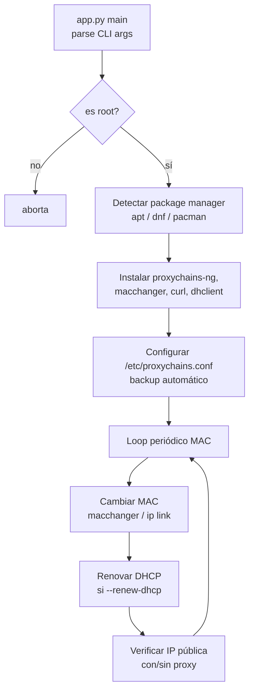

# anon-walk

Herramienta de mejora de anonimato en Linux: instala proxychains-ng y macchanger, configura proxychains y randomiza la dirección MAC de una interfaz de red periódicamente, con opción de renovación DHCP y verificación de IP pública.

[](LICENSE)
[](https://python.org)
[](https://github.com/bi0punk/anon-walk/actions/workflows/ci.yml)

## Contenido

- [Características](#características)
- [Arquitectura](#arquitectura)
- [Stack](#stack)
- [Estructura del repositorio](#estructura-del-repositorio)
- [Instalación](#instalación)
- [Uso](#uso)
- [Configuración](#configuración)
- [Tests / CI](#tests--ci)
- [Roadmap](#roadmap)
- [Licencia](#licencia)

## Características

- Instalación automática de proxychains-ng y macchanger (apt/dnf/pacman).
- Configuración de `/etc/proxychains.conf` con backup automático.
- Cambio periódico de MAC (intervalo configurable) usando macchanger o `ip link`.
- Renovación de DHCP tras cada cambio de MAC (dhclient, dhcpcd, nmcli).
- Verificación de IP pública antes/después con y sin proxy.
- Logging detallado con timestamps.
- Soporte de modos de proxychains (strict/dynamic/random) y `proxy_dns`.

## Arquitectura



## Stack

- **Python 3.11+** — argparse, threading, subprocess, logging (sin dependencias externas).
- **bash / system packages** — proxychains4, macchanger, curl, dhclient.

## Estructura del repositorio

```
anon-walk/
├── app.py               # Script principal (CLI)
├── pyproject.toml       # Definición del paquete + entry point `anon-walk`
├── tests/
│   ├── test_app.py
│   └── test_smoke.py
├── .env.example
├── .github/workflows/ci.yml
└── LICENSE
```

## Instalación

Requisitos: Python 3.11+, ejecución como root (`sudo`), Linux con apt/dnf/pacman y una interfaz de red.

```bash
git clone https://github.com/bi0punk/anon-walk
cd anon-walk
pip install -e .          # opcional: instala el comando `anon-walk`
```

## Uso

### Ejemplo básico

```bash
sudo python app.py --interface wlan0 --interval 10 \
  --proxies "socks5 127.0.0.1 9050" --mode strict_chain \
  --proxy-dns --renew-dhcp --immediate
```

Equivalente al instalarlo: `sudo anon-walk <mismos argumentos>`.

### Ejemplo con renovación DHCP

```bash
sudo python app.py --interface eth0 --interval 5 \
  --proxies "socks5 192.168.1.100 1080, http 10.0.0.1 3128" \
  --renew-dhcp --immediate
```

## Configuración

No requiere variables de entorno (`.env.example` vacío). Toda la configuración se pasa por argumentos CLI:

| Argumento | Default | Descripción |
|---|---|---|
| `--interface` | *(requerido)* | Interfaz de red (ej. wlan0, eth0) |
| `--interval` | `10` | Minutos entre cambios de MAC |
| `--proxies` | `socks5 127.0.0.1 9050` | Proxies separados por coma |
| `--mode` | `strict_chain` | Modo proxychains (strict/dynamic/random) |
| `--proxy-dns` | off | Activar resolución DNS vía proxy |
| `--renew-dhcp` | off | Renovar DHCP tras cada cambio de MAC |
| `--immediate` | off | Cambiar MAC inmediatamente al iniciar |
| `--no-install` | off | Saltar instalación automática de paquetes |
| `--logfile` | `/var/log/proxychains_macchanger.log` | Ruta del archivo de log |

La configuración de proxychains se escribe automáticamente en `/etc/proxychains.conf` con backup.

## Tests / CI

```bash
pip install pytest ruff
pytest -q
```

CI: GitHub Actions (`.github/workflows/ci.yml`) — **lint** (`ruff check .`) y **test** (`pytest -q`).

## Roadmap

- [x] Cambio periódico de MAC con y sin renovación DHCP
- [x] Configuración automática de proxychains
- [x] Verificación de IP pública
- [ ] Soporte para Tailscale/WireGuard
- [ ] Integración Tor
- [ ] Notificaciones de escritorio

Limitaciones: requiere root; solo Linux (macchanger, ip link, nmcli); depende de proxychains4, macchanger, curl y dhclient.

## Licencia

MIT — ver [LICENSE](LICENSE).